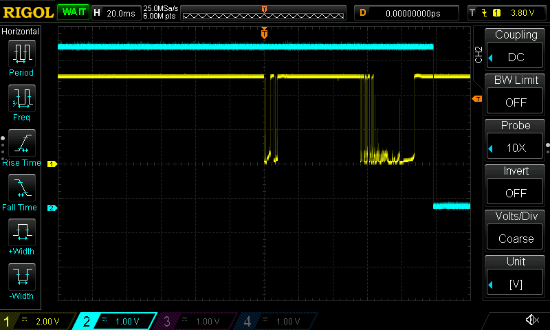
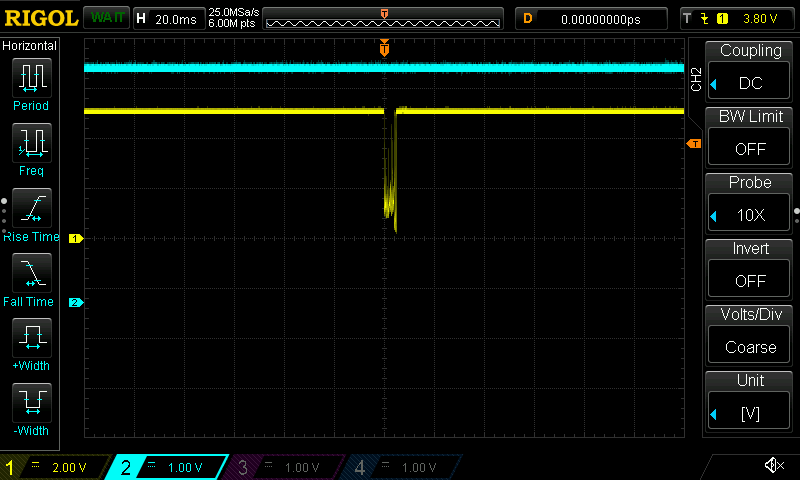
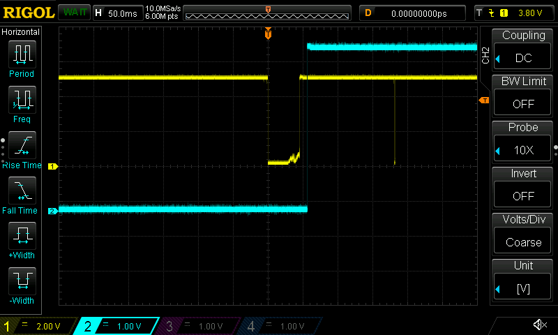

# Foundation Pack 01 — Non-Blocking Super-Loop

A PIC16F1827 application that blinks an LED every 500 ms and uses one pushbutton to switch between **RUNNING** and **PAUSED**. The firmware polls two hardware timers rather than relying on blocking delays or timer interrupts.

*Hardware demonstration video: to be added after recording.*

## 1. Project Objective

Design, implement, and test a non-blocking embedded application using the PIC16F1827 microcontroller. The aim was to build a practical understanding of GPIO configuration, timer calculations, state machines, and the difference between software behavior and real electrical signals.

### Functional Requirements

- Start in **RUNNING** with the heartbeat LED toggling every 500 ms.
- Accept a valid button press-release event to enter **PAUSED**, turning the heartbeat LED OFF.
- Accept the next valid event to resume a fresh 500 ms heartbeat interval.
- Monitor the button continuously, without calls such as `__delay_ms()`.
- Avoid repeated toggles while the button remains held.

## 2. Hardware

### Development Equipment

| Component | Description |
| --- | --- |
| Development board | Microchip Demo Board, 02-01630-1 |
| Microcontroller | PIC16F1827 |
| Programmer/debugger | MPLAB ICD 3 |
| Development tools | MPLAB X IDE, XC8 |
| Oscilloscope | Rigol DS1054Z |

### Hardware Connections

| Component | Connection | Purpose |
| --- | --- | --- |
| D1 | Onboard | Power indicator |
| D2 | RB0 through J6 | 500 ms heartbeat LED |
| S2 | RA4 | Active-LOW button input |
| Onboard pull-up | 4.7 kΩ | Holds RA4 HIGH when released |
| Onboard LED resistor | 470 Ω | LED current limiting |
| Diagnostic LED | RB1 | ON in PAUSED, OFF in RUNNING |

Jumper J6 connects the onboard PORTB LEDs. No external button or LED circuit was needed.

## 3. Super-Loop Architecture

The main loop keeps two independent activities moving: it checks the button's debounce state and polls Timer1 for the heartbeat. Neither activity waits for the other to finish, and no interrupt service routine is used.

Two state variables keep the responsibilities separate: `systemState` tracks **RUNNING/PAUSED**, while `buttonState` tracks progress through a full press-and-release event. This separation also made debugging easier: RB1 could indicate a confirmed system-state change without relying on the heartbeat LED.

## 4. Application States

### RUNNING

The heartbeat LED on RB0 toggles every 500 ms. The pushbutton remains active. A confirmed press-and-release event enters **PAUSED**.

### PAUSED

Timer1 is stopped and RB0 is held OFF. The button remains active; the next confirmed event returns the application to **RUNNING**. RB1 is ON only while paused.

### Button Debounce State Machine

Mechanical contacts can bounce before settling. This application uses a **wait-then-sample** approach: detect a candidate edge, allow approximately 10 ms for bouncing, then sample RA4 to accept or reject that candidate.

1. `BUTTON_WAIT_PRESS` — detect a LOW, reset Timer0, and begin press validation.
2. `BUTTON_DEBOUNCE_PRESS` — after the interval, accept LOW and move to `BUTTON_WAIT_RELEASE`; otherwise return to `BUTTON_WAIT_PRESS`.
3. `BUTTON_WAIT_RELEASE` — detect a HIGH, reset Timer0, and begin release validation.
4. `BUTTON_DEBOUNCE_RELEASE` — after the interval, accept HIGH and change the system state; otherwise return to `BUTTON_WAIT_RELEASE`.

The design deliberately **allows** bouncing during the waiting period; it does not claim to prove the signal stayed continuously stable for 10 ms. A key firmware correction was to add the missing rejection branches. A failed release must not erase a previously confirmed press.

## 5. Timing

Timer0 was initially considered for the heartbeat. Under the chosen settings, its 8-bit counter could not produce a 500 ms interval with a single overflow without additional software tracking. The 16-bit Timer1 made that part simpler; Timer0 remained useful for short debounce intervals.

| Setting | Value / reasoning |
| --- | --- |
| Internal oscillator | 500 kHz |
| Instruction clock | 125 kHz (`Fosc / 4`) |
| Timer1 | 1:1 prescaler; preload `0x0BDC` (3036) |
| Timer1 interval | 62,500 counts × 8 µs = **nominal 500 ms** |
| Timer0 | 1:128 prescaler, approximately 1.024 ms per count |
| Debounce threshold | `TMR0 >= 10`, approximately 10.24 ms plus polling overhead |

When paused, Timer1 stops, its overflow flag is cleared, and RB0 turns OFF. On resume, the timer is reloaded, its flag cleared, and counting restarts. The 500 ms heartbeat was checked on the scope earlier in development. The captures below focus on button electrical behavior, not precision heartbeat metrology.

## 6. Test Evidence

Testing used the real PIC board and a Rigol DS1054Z. **CH1 (yellow)** monitored RA4, the electrical button input; **CH2 (cyan)** monitored RB1, the independently driven system-state indicator. A change on RB1 shows that the application accepted an event and updated `systemState`.

### Representative captures

**Test 02 — PAUSED → RUNNING.** RA4 shows a press-and-release sequence, and RB1 changes from HIGH to LOW as expected.

**Test 04 — missed PAUSED → RUNNING request.** RA4 shows only a brief, incomplete LOW-going disturbance; RB1 stays HIGH. This supports an input-contact problem rather than a Timer1-only problem. The image alone does not establish an exact pulse-width threshold.

**Test 06 — RUNNING → PAUSED.** RA4 shows a press-and-release event; RB1 changes LOW to HIGH.

### Six-trial log

| Trial | Intended transition | Observation | Evidence |
| --- | --- | --- | --- |
| 01 | RUNNING → PAUSED | Transition observed | [Capture](images/test_01.png) |
| 02 | PAUSED → RUNNING | Transition observed | [Capture](images/test_02.png) |
| 03 | RUNNING → PAUSED | Transition observed | [Capture](images/test_03.png) |
| 04 | PAUSED → RUNNING | No transition; brief/abnormal RA4 signal | [Capture](images/test_04.png) |
| 05 | PAUSED → RUNNING | Operator confirmed RUNNING; screenshot does **not** independently show RB1 changing | [Capture](images/test_05.png) |
| 06 | RUNNING → PAUSED | Transition observed | [Capture](images/test_06.png) |

An earlier 20-cycle functional check produced **17 successful operations and 3 misses**. Because valid electrical input was not verified on every one of those trials, that number describes the combined board behavior—not a measured firmware-only reliability rate.

## 7. What Failed and Troubleshooting

The application began showing occasional missed button events, especially during short presses. Timer0 overflow and debounce control flow were early suspects. Code review uncovered missing rejection paths in the button-state machine, which were corrected. The Timer1 overflow flag handling on resume was also tightened.

Some misses remained on hardware despite correct behavior in simulation. To distinguish button processing from heartbeat timing, RB1 was added as an independent indicator of accepted RUNNING/PAUSED transitions. Scope captures then showed a pattern: valid input events generally produced the expected state change, while some missed presses produced no proper LOW at RA4. In one capture, the input only dipped briefly instead of making a sustained LOW transition. Resistance measurements around the switch were also unusual, and cleaning the switch appeared to improve its response.

**Engineering conclusion:** The evidence strongly suggests an intermittent switch contact or nearby connection issue. It does not isolate the exact failed physical component or prove the firmware has no remaining defects. Replacing the suspect switch is the recommended hardware corrective action if the board remains in service. No further switch experiments were needed for this foundation exercise.

## 8. Engineering Takeaways

1. **Match timer capabilities to the timing job.** Timer1 simplified the 500 ms heartbeat; Timer0 provided the shorter debounce interval without blocking the loop.
2. **Handle unsuccessful state transitions explicitly.** Confirming a press is only half the design. Failed press and release candidates must return to the correct waiting states.
3. **Use measurements to separate software and hardware symptoms.** Watching RA4 alongside the independent RB1 indicator made it possible to distinguish a questionable input signal from the system's response, and to stop investigating once the evidence supported a defensible conclusion.

**Project status:** The intended foundation-level behaviors were implemented and demonstrated. The intermittent button-contact limitation is documented; this is not a claim of production-grade hardware reliability.
