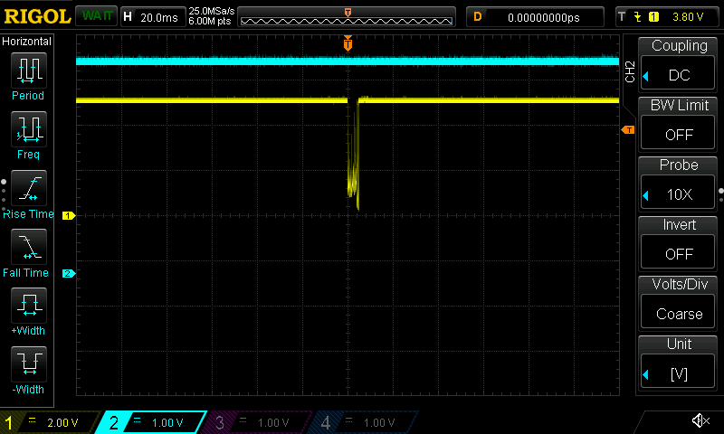

# PIC16F1827 — Non-Blocking Heartbeat and Pushbutton Control

**Register-level embedded C | Hardware timers | State machines | Oscilloscope-based fault isolation**

This firmware implements a periodic LED heartbeat and pushbutton-controlled RUNNING and PAUSED states on a PIC16F1827. The polling baseline uses two hardware timers and a non-blocking super-loop. A subsequent revision moves heartbeat generation into a Timer1 interrupt service routine while retaining the button state machine.

## Implementation revisions

| Revision                                                                                                          | Architecture                         | Documentation                                                                                                                                           |
| ----------------------------------------------------------------------------------------------------------------- | ------------------------------------ | ------------------------------------------------------------------------------------------------------------------------------------------------------- |
| Polling baseline (`main`)                                                                                         | Timer0 and Timer1 polling            | [Hardware validation report](docs/VALIDATION_REPORT.md)                                                                                                 |
| [Interrupt-driven revision](https://github.com/bob7185/Embedded_Foundations_Pack01/tree/feature/timer1-interrupt) | Timer1 ISR and Timer0 button polling | [Interrupt validation report](https://github.com/bob7185/Embedded_Foundations_Pack01/blob/feature/timer1-interrupt/docs/INTERRUPT_VALIDATION_REPORT.md) |

[Watch the 21-second polling implementation bench demonstration](https://youtu.be/MK6W9Lwu7xg).

## 1. Project Objective

Implement and validate a register-level embedded C application that generates a periodic heartbeat and processes a mechanical pushbutton without blocking delays.

### Functional requirements

- Initialize in RUNNING, toggling RB0 at a nominal 500 ms interval (1 Hz full waveform).
- Accept a qualified press-and-release event to enter PAUSED and force the heartbeat output LOW.
- Accept the next qualified event to return to RUNNING with a fresh heartbeat interval.
- Monitor the button in both states without blocking delay calls such as `__delay_ms()`.
- Prevent repeated state changes while the button remains held.

## 2. Hardware

| Equipment           | Description                      |
| ------------------- | -------------------------------- |
| Development board   | Microchip Demo Board, 02-01630-1 |
| Microcontroller     | PIC16F1827                       |
| Programmer/debugger | MPLAB ICD 3                      |
| Development tools   | MPLAB X IDE, XC8                 |
| Oscilloscope        | Rigol DS1054Z                    |

| Component            | Connection     | Purpose                        |
| -------------------- | -------------- | ------------------------------ |
| D1                   | Onboard        | Power indicator                |
| D2                   | RB0 through J6 | Heartbeat LED                  |
| S2                   | RA4            | Active-LOW pushbutton          |
| Onboard pull-up      | 4.7 kΩ         | Holds RA4 HIGH when released   |
| Onboard LED resistor | 470 Ω          | LED current limiting           |
| Diagnostic LED       | RB1            | HIGH in PAUSED, LOW in RUNNING |

Jumper J6 connects the onboard PORTB LEDs. The original tactile switch was subsequently replaced following the fault investigation described below.

## 3. Super-Loop Architecture

The main loop polls Timer1 for heartbeat timing and Timer0 for button qualification. Neither activity uses blocking delays or an interrupt service routine.

```text
Timer1 overflow ──> main-loop polling ──> RB0 heartbeat
RA4 button ───────> Timer0 debounce ────> qualified release
                                           └─ RUNNING / PAUSED transition
```

The application separates `systemState`, which tracks RUNNING and PAUSED, from `buttonState`, which tracks press-and-release qualification. RB1 provides an independent indication of application-state changes.

## 4. Application States and Button Qualification

| State   | RB0 heartbeat                | RB1 diagnostic | Button monitoring |
| ------- | ---------------------------- | -------------- | ----------------- |
| RUNNING | Toggles every nominal 500 ms | LOW            | Active            |
| PAUSED  | Held LOW; Timer1 stopped     | HIGH           | Active            |

The debounce state machine uses a wait-then-sample approach:

1. `BUTTON_WAIT_PRESS` — detect LOW, reset Timer0 and begin press qualification.
2. `BUTTON_DEBOUNCE_PRESS` — after the threshold, accept LOW and advance to `BUTTON_WAIT_RELEASE`; otherwise return to `BUTTON_WAIT_PRESS`.
3. `BUTTON_WAIT_RELEASE` — detect HIGH, reset Timer0 and begin release qualification.
4. `BUTTON_DEBOUNCE_RELEASE` — after the threshold, accept HIGH and change the application state; otherwise return to `BUTTON_WAIT_RELEASE`.

The design allows contact bounce during the waiting interval; it does not establish continuous input stability throughout that interval. A failed release candidate preserves the previously qualified press.

## 5. Timing Design

The 8-bit Timer0 cannot generate the required 500 ms interval with a single overflow under the selected clock settings without additional software tracking. Timer1 provides the longer interval, while Timer0 qualifies button events.

| Setting                      | Value                                                |
| ---------------------------- | ---------------------------------------------------- |
| Internal oscillator, nominal | 500 kHz                                              |
| Instruction clock            | 125 kHz (`Fosc / 4`)                                 |
| Timer1 prescaler             | 1:1                                                  |
| Timer1 tick                  | 8 µs                                                 |
| Timer1 preload               | `0x0BDC` (3036)                                      |
| Nominal Timer1 interval      | 62,500 counts × 8 µs = 500 ms                        |
| Timer0 prescaler             | 1:128                                                |
| Timer0 tick                  | 1.024 ms                                             |
| Debounce threshold           | `TMR0 >= 10`, nominal 10.24 ms plus polling overhead |

When paused, Timer1 stops, its overflow flag is cleared and RB0 is forced LOW. On resume, the counter is reloaded, the flag cleared and counting restarted. Actual timing depends on oscillator accuracy and polling/reload latency. The captures below focus on input behavior rather than precision heartbeat metrology.

## 6. Hardware Verification

The Rigol DS1054Z monitored RA4 on CH1 (yellow) and RB1 on CH2 (cyan). RB1 indicates whether the application accepted a button event and changed state independently of the heartbeat.

**Test 02 — PAUSED → RUNNING.** RA4 press-and-release followed by RB1 HIGH → LOW.


**Test 04 — Missed PAUSED → RUNNING request.** An incomplete LOW-going RA4 disturbance occurs while RB1 remains HIGH. The capture supports an input-path issue but does not establish an exact pulse-width threshold.



**Test 06 — RUNNING → PAUSED.** RA4 press-and-release followed by RB1 LOW → HIGH.


| Trial | Intended transition | Observation                                                                     | Evidence                             |
| ----- | ------------------- | ------------------------------------------------------------------------------- | ------------------------------------ |
| 01    | RUNNING → PAUSED    | Transition observed                                                             | [Capture](docs/evidence/test_01.png) |
| 02    | PAUSED → RUNNING    | Transition observed                                                             | [Capture](docs/evidence/test_02.png) |
| 03    | RUNNING → PAUSED    | Transition observed                                                             | [Capture](docs/evidence/test_03.png) |
| 04    | PAUSED → RUNNING    | No transition; abnormal RA4 signal                                              | [Capture](docs/evidence/test_04.png) |
| 05    | PAUSED → RUNNING    | Operator confirmed RUNNING; transition not independently visible in saved frame | [Capture](docs/evidence/test_05.png) |
| 06    | RUNNING → PAUSED    | Transition observed                                                             | [Capture](docs/evidence/test_06.png) |

An earlier 20-actuation check produced 17 successes and three misses. Electrical validity was not established for each attempt, so this is a combined board-behavior result, not a firmware-only reliability rate.

## 7. Fault Investigation and Corrective Action

Intermittent missed events initially prompted investigation of Timer0 and debounce control flow. Source review identified missing rejection paths in the button state machine, which were corrected. Timer1 overflow-flag handling on resume was also tightened.

Misses persisted on hardware despite correct behavior in simulation. RB1 was introduced to distinguish accepted application-state transitions from heartbeat activity. Oscilloscope captures associated some missed events with incomplete or intermediate-voltage RA4 signals. In-circuit resistance measurements appeared inconsistent; cleaning the switch improved operation but did not eliminate all observed misses.

The evidence supported an intermittent switch contact or adjacent input connection fault without isolating the exact physical failure mechanism.

On November 15, 2026, the RA4 tactile switch was replaced. Regression testing with the polling firmware produced the following results:

| Actuation category | Result |
| ------------------ | -----: |
| Normal             |  10/10 |
| Short              |    5/5 |
| Long               |    5/5 |
| Total              |  20/20 |

The previously observed intermittent symptom was not reproduced following replacement under these test conditions. See the [complete hardware validation report](docs/VALIDATION_REPORT.md).

## 8. Engineering Conclusions and Development Progression

The polling implementation demonstrates independent timer servicing, non-blocking button qualification and explicit application-state transitions. The input investigation illustrates the value of monitoring both the electrical input and an independent firmware state indicator.

The [interrupt-driven revision](https://github.com/bob7185/Embedded_Foundations_Pack01/tree/feature/timer1-interrupt) removes heartbeat servicing from the polling loop. Its separate validation report documents two Timer1 configurations, pause/resume behavior, button regression and power-on initialization tests. The polling implementation remains on `main` as the original architecture reference.

The reported bench tests demonstrate the defined behavior under the recorded conditions. They do not establish production reliability, absolute timing accuracy or a formal worst-case response bound.
