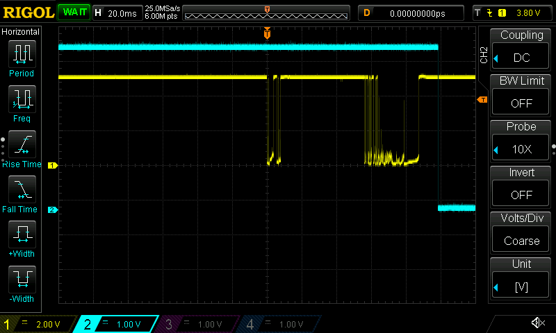
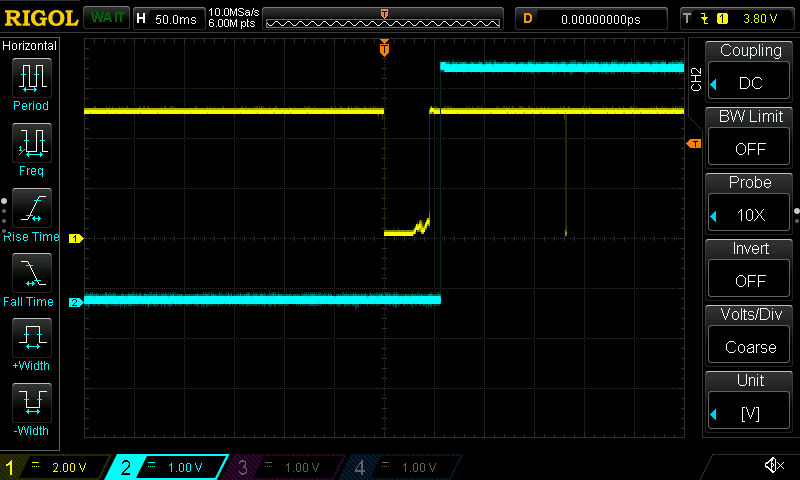
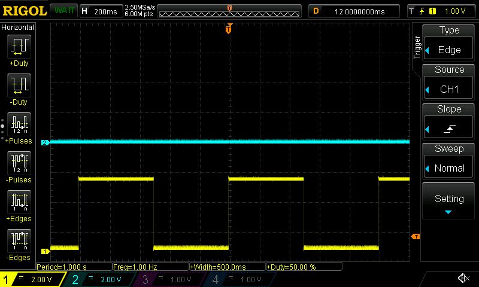

# PIC16F1827 — Non-Blocking Heartbeat and Pushbutton Control

**Interrupt-driven heartbeat | Register-level C | Hardware timer validation | Non-blocking state machine**

This PIC16F1827 firmware application uses Timer1 interrupts to toggle an LED at a nominal 500 ms interval and a Timer0-based, non-blocking button state machine to control RUNNING and PAUSED modes. It builds on a polling implementation and includes physical timing measurements, input fault investigation, switch replacement and regression testing.

[Watch the 21-second bench demonstration of the original polling implementation](https://youtu.be/MK6W9Lwu7xg).

**Development progression:** [polling baseline (`main`)](https://github.com/bob7185/Embedded_Foundations_Pack01/tree/main) → interrupt-driven implementation (this branch).

## 1. Project Objective

Implement a register-level embedded C application that generates a periodic heartbeat while responding to an active-LOW mechanical pushbutton without blocking delays. The project separates periodic output timing from button qualification and application-state management, and uses oscilloscope measurements to verify hardware behavior.

### Functional Requirements

- Initialize in **RUNNING**, with the heartbeat LED toggling at a nominal 500 ms interval (1 Hz full waveform).
- Accept a qualified press-and-release event to enter **PAUSED**, stop the heartbeat, and hold its output LOW.
- Accept the next qualified press-and-release event to return to RUNNING with a fresh heartbeat interval.
- Continue processing the button in both application states without blocking delay calls such as `__delay_ms()`.
- Prevent repeated state changes while the button remains held.

## 2. Hardware

### Development Equipment

| Component | Description |
| --- | --- |
| Development board | Microchip Demo Board, 02-01630-1 |
| Microcontroller | PIC16F1827 |
| Programmer/debugger | MPLAB ICD 3 |
| Development tools | MPLAB X IDE, XC8 |
| Oscilloscope | Rigol DS1054Z |

### Hardware Connections

| Component | Connection | Purpose |
| --- | --- | --- |
| D1 | Onboard | Power indicator |
| D2 | RB0 through J6 | Heartbeat LED |
| S2 | RA4 | Active-LOW button input |
| Onboard pull-up | 4.7 kΩ | Holds RA4 HIGH when released |
| Onboard LED resistor | 470 Ω | LED current limiting |
| Diagnostic LED | RB1 | HIGH in PAUSED, LOW in RUNNING |

Jumper J6 connects the onboard PORTB LEDs. The initial implementation used the onboard button and LEDs; the suspect tactile switch was subsequently replaced as described in the validation report.

## 3. Firmware Architecture

### Baseline: Polling

The original super-loop polls Timer0 for debounce timing and Timer1 for the heartbeat. Heartbeat servicing therefore depends on the main loop reaching the overflow check. The polling version is retained on [`main`](https://github.com/bob7185/Embedded_Foundations_Pack01/tree/main).

### Revision: Timer1 Interrupts

The revised firmware moves heartbeat generation into a short Timer1 interrupt service routine (ISR). The main loop continues to handle button qualification and RUNNING/PAUSED transitions. No shared event flag or software scheduler is required for the direct LED toggle.

```text
Timer1 overflow ──> ISR: reload counter, clear flag, toggle RB0
                                   
RA4 button ──> Timer0 debounce ──> qualified release ──> state transition
                                                       ├─ Timer1 enable/disable
                                                       └─ RB1 state indicator
```

The ISR checks `TMR1IE` and `TMR1IF` before processing the overflow. At startup, the counter is loaded, the pending flag is cleared, and Timer1, peripheral and global interrupt enables are configured before the timer starts.

On entry to PAUSED, the main loop masks the Timer1 interrupt, stops the timer, clears the pending overflow flag, sets RB1 HIGH, forces RB0 LOW and updates the application state. Masking before stopping and clearing prevents servicing a new Timer1 event after the mask takes effect.

On resume, the counter is reloaded and the flag cleared before enabling the interrupt and restarting Timer1. RB1 is then set LOW and the application state becomes RUNNING. The first heartbeat edge occurs after a new nominal 500 ms interval.

This design removes the dependence of heartbeat servicing on the main loop's polling position. It does not establish a measured worst-case interrupt-latency bound or general real-time scheduling capability.

## 4. Application States and Button Qualification

| Application state | Heartbeat (RB0) | Diagnostic output (RB1) | Button monitoring |
| --- | --- | --- | --- |
| RUNNING | Toggles every nominal 500 ms | LOW | Active |
| PAUSED | Held LOW; Timer1 stopped | HIGH | Active |

A qualified press-and-release event changes the application state exactly once. The button and application state variables (`buttonState` and `systemState`) track separate concerns.

### Button Debounce State Machine

Mechanical contacts can bounce before settling. The application uses a wait-then-sample approach: detect a candidate edge, allow approximately 10 ms for settling, then sample RA4 to accept or reject the candidate.

1. `BUTTON_WAIT_PRESS` — detect LOW, reset Timer0, and begin press qualification.
2. `BUTTON_DEBOUNCE_PRESS` — after the interval, accept LOW and move to `BUTTON_WAIT_RELEASE`; otherwise return to `BUTTON_WAIT_PRESS`.
3. `BUTTON_WAIT_RELEASE` — detect HIGH, reset Timer0, and begin release qualification.
4. `BUTTON_DEBOUNCE_RELEASE` — after the interval, accept HIGH and change the application state; otherwise return to `BUTTON_WAIT_RELEASE`.

The design does not require the input to remain continuously stable throughout the debounce interval. A failed release preserves the earlier qualified press. Holding the button does not repeatedly toggle the application state.

## 5. Timing Design

Timer0 was initially considered for the heartbeat. Under the selected clock settings, its 8-bit counter cannot provide a 500 ms interval with a single overflow without additional software tracking. The 16-bit Timer1 provides the longer interval, while Timer0 is used for the shorter debounce interval.

| Setting | Value |
| --- | --- |
| Internal oscillator, nominal | 500 kHz |
| Instruction clock | 125 kHz (`Fosc / 4`) |
| Timer1 prescaler | 1:1 |
| Timer1 tick | 8 µs |
| Timer1 preload | `0x0BDC` (3036) |
| Nominal Timer1 overflow interval | (65,536 − 3,036) × 8 µs = 500 ms |
| Timer0 prescaler | 1:128 |
| Timer0 tick | 1.024 ms |
| Debounce threshold | `TMR0 >= 10` (nominal 10.24 ms plus software overhead) |

These are nominal timing calculations, not absolute timing guarantees. Actual intervals depend on oscillator accuracy, timer reload timing and software response.

## 6. Polling Implementation — Hardware Verification

The original hardware investigation used a Rigol DS1054Z with **CH1 (yellow) = RA4** and **CH2 (cyan) = RB1**. Monitoring the input and an independent state indicator made it possible to distinguish a questionable electrical input from a confirmed application-state change.

### Representative Captures

**Test 02 — PAUSED → RUNNING.** A press-and-release event is followed by RB1 changing HIGH to LOW.



**Test 04 — Missed PAUSED → RUNNING request.** RA4 shows a brief, incomplete LOW-going disturbance while RB1 remains HIGH. The capture supports an input-path issue; it does not establish an exact pulse-width threshold.


**Test 06 — RUNNING → PAUSED.** RA4 shows a press-and-release event followed by RB1 changing LOW to HIGH.



### Six-Trial Log

| Trial | Intended transition | Observation | Evidence |
| --- | --- | --- | --- |
| 01 | RUNNING → PAUSED | Transition observed | [Capture](docs/evidence/test_01.png) |
| 02 | PAUSED → RUNNING | Transition observed | [Capture](docs/evidence/test_02.png) |
| 03 | RUNNING → PAUSED | Transition observed | [Capture](docs/evidence/test_03.png) |
| 04 | PAUSED → RUNNING | No transition; abnormal RA4 signal | [Capture](docs/evidence/test_04.png) |
| 05 | PAUSED → RUNNING | Operator confirmed RUNNING; transition not independently visible in saved frame | [Capture](docs/evidence/test_05.png) |
| 06 | RUNNING → PAUSED | Transition observed | [Capture](docs/evidence/test_06.png) |

An earlier 20-actuation check produced 17 successful operations and three misses. Electrical validity was not established for every attempt, so this result describes combined board behavior rather than a firmware-only reliability rate.

## 7. Fault Investigation and Corrective Action

Intermittent missed events were initially investigated as possible Timer0 or debounce-control-flow faults. Source review identified missing rejection paths in the button state machine, which were corrected. Timer1 overflow-flag handling on resume was also tightened.

Misses persisted on the physical board despite correct behavior in simulation. RB1 was introduced as an independent indication of accepted application-state changes. Oscilloscope captures showed valid input events generally produced the expected state transition, whereas some missed events coincided with incomplete or intermediate-voltage RA4 signals. In-circuit resistance measurements were inconsistent; cleaning the switch improved operation but did not eliminate all observed misses.

The evidence supported an intermittent switch contact or adjacent input connection fault. It did not isolate a specific failure mechanism within the switch.

On November 15, 2026, the RA4 tactile switch was replaced. A separate regression run with the polling firmware recorded **10/10 normal, 5/5 short and 5/5 long actuations**, with no misses. The previously observed symptom was not reproduced under those test conditions.

See the [polling validation and fault investigation report](docs/VALIDATION_REPORT.md) for the complete trial record, corrective action and test limitations.

## 8. Interrupt Implementation — Hardware Verification

For the interrupt measurements, the scope channels were reassigned: **CH1 = RB0 heartbeat**, **CH2 = RB1 state indicator**. The displayed steady-state results for the final 1:1 configuration were:

| Measurement | Nominal target | Observed |
| --- | ---: | ---: |
| Period | 1 s | 1.000 s |
| Frequency | 1 Hz | 1.00 Hz |
| Positive pulse width | 500 ms | 500.0 ms |
| Duty cycle | 50% | 50.00% |



The [pause capture](docs/evidence/interrupt_test_02.jpeg) shows RB1 going HIGH and RB0 being forced LOW. The [resume capture](docs/evidence/interrupt_test_03.jpeg) shows RB1 returning LOW, followed by the first rising heartbeat edge approximately 500 ms later.

### Alternative Timer1 Configuration

An independently evaluated 1:8 prescaler configuration uses a 64 µs tick and preload `0xE17B` (57,723), giving 7,813 counts and a nominal 500.032 ms overflow interval. The scope displayed a 1.002 s period and 500.0 ms positive pulse width. Manual measurements of three consecutive intervals were 504, 500 and 508 ms. The 32 µs theoretical quantization error was not resolved by this measurement setup. The final firmware retains the 1:1 configuration.

### Functional Regression and Reset

| Test | Observed result |
| --- | --- |
| Interrupt firmware button regression | 20/20 actuations; no misses |
| Pause and resume | Expected output and state transitions |
| Power cycle from RUNNING | Reinitialized in RUNNING |
| Power cycle from PAUSED | Reinitialized in RUNNING |

Power-cycle results are based on direct bench observation. External MCLR is disabled in `config.h`; these tests validate power-on initialization, not an external reset input.

See the [interrupt validation report](docs/INTERRUPT_VALIDATION_REPORT.md) for complete calculations, procedures, measurements and evidence.

## 9. Design Conclusions and Scope

- Separate periodic timing from user-input qualification and application state management.
- Select timer settings using counter width, tick resolution and quantization calculations.
- Clear pending flags and control interrupt enables explicitly at state transitions.
- Use an independent state indicator and oscilloscope captures to investigate electrical and firmware behavior.

Both implementations demonstrate the defined heartbeat and pushbutton functions under the recorded bench conditions. The interrupt revision preserves the original application behavior while changing how Timer1 overflow is serviced. The measured agreement with nominal timing is limited by oscillator and instrument accuracy, and the regression runs are finite functional checks rather than production reliability qualification. No formal worst-case interrupt-latency characterization, watchdog recovery or brown-out testing is claimed.
