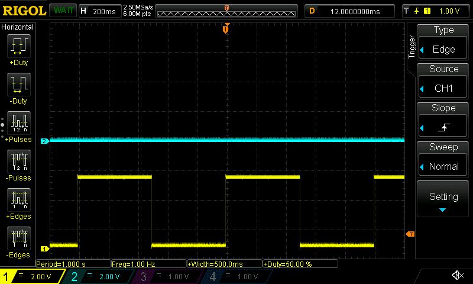
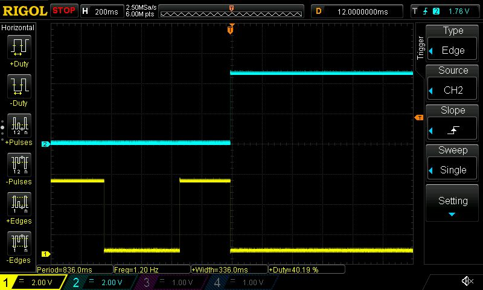
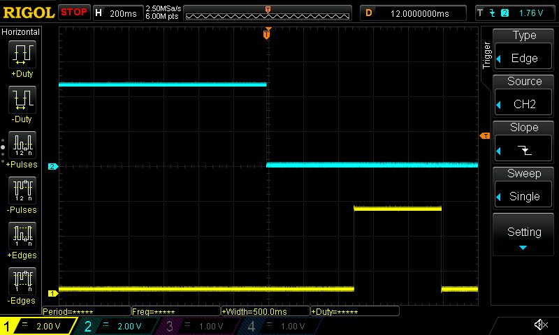
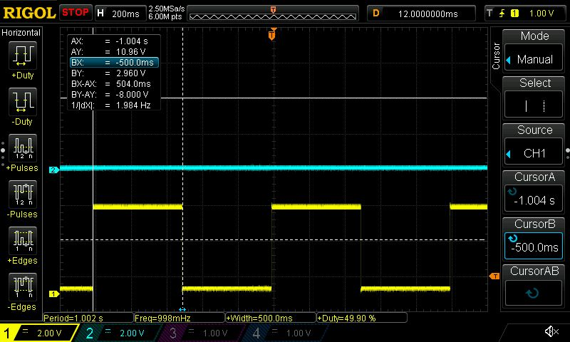
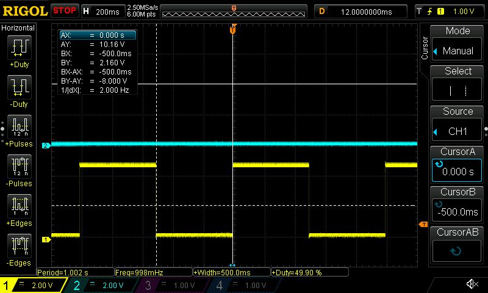
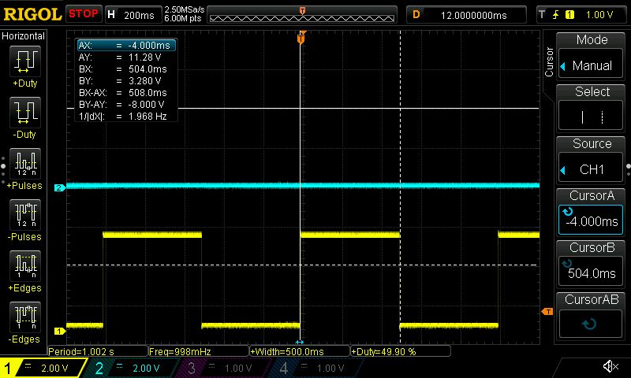

# Timer1 Interrupt Implementation — Hardware Validation Report

**Date:** November 15, 2026  
**Target:** PIC16F1827  
**Implementation:** `feature/timer1-interrupt`  
**Source checkpoint:** [`2c46675`](https://github.com/bob7185/Embedded_Foundations_Pack01/commit/2c4667540d7112627579914b64bb55d17ae13f5c)  
**Instrument:** Rigol DS1054Z  
**Scope channels:** CH1 (yellow) = RB0 heartbeat; CH2 (cyan) = RB1 state indicator.

## 1. Objective

Replace polling-based Timer1 heartbeat servicing with an interrupt-driven implementation while retaining the existing non-blocking button debounce state machine and RUNNING/PAUSED behavior. Verify steady-state output timing, state transitions, button operation, a second timer configuration and initialization after power cycling.

## 2. Timer Configuration and Predicted Timing

The oscillator is configured for a nominal 500 kHz. Timer1 uses the instruction clock (`Fosc/4`), nominally 125 kHz. For a prescaler P and 16-bit preload, the ideal counter interval is:

```text
T_tick = P / (Fosc / 4)
N = 65536 - preload
T_overflow = N × T_tick
T_heartbeat = 2 × T_overflow
```

| Parameter | Final 1:1 configuration | Alternate 1:8 configuration |
| --- | ---: | ---: |
| Timer tick | 8 µs | 64 µs |
| Ideal counts for 500 ms | 62,500 | 7,812.5 |
| Implemented counts | 62,500 | 7,813 |
| Preload (decimal) | 3,036 | 57,723 |
| Preload (hex) | `0x0BDC` | `0xE17B` |
| Predicted overflow interval | 500.000 ms | 500.032 ms |
| Predicted full waveform period | 1.000000 s | 1.000064 s |
| Nominal quantization error | 0 | +32 µs (+0.0064%) |

With the 1:8 prescaler, rounding to 7,812 counts instead would use preload `0xE17C` and yield 499.968 ms (−32 µs). The alternate hardware test used the 7,813-count setting. The 1:1 configuration is retained in the final implementation because its nominal count calculation has no fractional-tick rounding error.

Counter predictions exclude oscillator tolerance, interrupt response and reload overhead. Zero nominal quantization error is not a claim of zero physical timing error.

## 3. Firmware Architecture and Design Rationale

The Timer1 ISR checks `TMR1IE` and `TMR1IF`, reloads the high and low counter bytes, clears the overflow flag and invokes `ledToggle()` to update RB0. The operation is short and does not require a shared event flag or a deferred handoff to the main loop. Heartbeat servicing therefore does not require the main loop to reach a polling check.

The main loop owns the Timer0-based button qualification state machine and application-state transitions. The Timer0 debounce configuration and press/release rejection behavior are preserved from the polling baseline.

### Initialization

The firmware configures the oscillator and GPIO, loads Timer1, initializes the application to RUNNING and drives RB1 LOW. It clears `TMR1IF`, enables the Timer1 interrupt (`TMR1IE`), peripheral interrupts (`PEIE`) and global interrupts (`GIE`), then starts Timer1. Enabling the global interrupt last is a defensive initialization convention; clearing pending flags before enabling the relevant service path is the essential condition in this configuration.

### Transition to PAUSED

1. Disable the Timer1 interrupt (`TMR1IE = 0`).
2. Stop Timer1 (`TMR1ON = 0`).
3. Clear `TMR1IF`.
4. Drive RB1 HIGH.
5. Drive RB0 LOW.
6. Set the application state to PAUSED.

Masking the interrupt before stopping the timer and clearing the flag prevents Timer1 servicing after the mask takes effect. Clearing before stopping could allow another overflow to set the flag again. Stopping and clearing without first masking leaves a window in which a pending interrupt could be serviced. An interrupt occurring before the mask takes effect is still possible; the state-entry actions subsequently force the heartbeat output LOW.

### Transition to RUNNING

1. Reload Timer1.
2. Clear `TMR1IF`.
3. Enable the Timer1 interrupt.
4. Start Timer1.
5. Drive RB1 LOW.
6. Set the application state to RUNNING.

The reload and flag-clear sequence establishes a fresh timer interval rather than inheriting a pending overflow. No formal worst-case interrupt response measurement was performed.

## 4. Hardware Validation — Final 1:1 Configuration

### Test 01 — Steady-State Timing

| Measurement | Nominal target | Observed |
| --- | ---: | ---: |
| Frequency | 1 Hz | 1.00 Hz |
| Period | 1 s | 1.000 s |
| Positive pulse width | 500 ms | 500.0 ms |
| Duty cycle | 50% | 50.00% |

**Result:** PASS. Measurements agree with the nominal targets at the displayed instrument precision. The capture shows multiple steady-state transitions; the numeric values above are the instrument's automatic measurements, not separately logged manual cursor readings for every interval.



### Test 02 — Pause Transition

RB1 transitions HIGH and RB0 is driven LOW. The heartbeat remains LOW throughout the captured paused interval of approximately 1.2 s. The active positive pulse is deliberately terminated when PAUSED is entered; its displayed width is 336 ms. This truncated pulse is a state-transition effect, not a steady-state timing error.

**Result:** PASS.



### Test 03 — Resume Transition

RB1 transitions LOW and RB0 remains LOW for approximately 500 ms before its first rising edge. The first positive pulse width is displayed as 500.0 ms. No premature heartbeat edge is visible in the capture.

**Result:** PASS.



### Test 04 — Button Functional Regression

The RA4 tactile switch had been replaced following the input-path fault investigation described in the [polling validation report](VALIDATION_REPORT.md). A separate regression run with the interrupt firmware yielded:

| Physical actuation | Successful / attempted |
| --- | ---: |
| Normal presses | 10/10 |
| Short presses | 5/5 |
| Long presses | 5/5 |
| **Total** | **20/20** |

**Result:** PASS; zero missed actuations reported by direct bench observation. This finite test does not establish a statistical reliability guarantee.

## 5. Hardware Validation — Alternative 1:8 Configuration

The alternative prescaler and preload were applied temporarily at initialization, in the ISR and on resume. The application architecture was unchanged. A steady-state acquisition was recorded using a horizontal scale of 200 ms/div. The following manual cursor readings are from three successive pulse intervals within the same acquisition.

| Interval | Predicted counter interval | Measured cursor separation | Relative deviation | Evidence |
| --- | ---: | ---: | ---: | --- |
| First HIGH | 500.032 ms | 504 ms | +0.794% | [Capture](evidence/timer1_prescaler_1to8_high_1.jpeg) |
| Following LOW | 500.032 ms | 500 ms | −0.0064% | [Capture](evidence/timer1_prescaler_1to8_low_1.jpeg) |
| Second HIGH | 500.032 ms | 508 ms | +1.593% | [Capture](evidence/timer1_prescaler_1to8_high_2.jpeg) |
| Additional LOW | 500.032 ms | 492 ms | −1.606% | [Capture](evidence/timer1_prescaler_1to8_low_2.jpeg) |

An initial cursor placement indicated 512 ms for the second HIGH interval; the cursors were repositioned to obtain the 508 ms reading above. The [initial capture](evidence/timer1_prescaler_1to8_high_2_initial.jpeg) is retained for traceability, not counted as another interval.

### Representative Cursor Captures







### Automatic Oscilloscope Measurements

| Parameter | Predicted | Displayed |
| --- | ---: | ---: |
| Period | 1.000064 s | 1.002 s |
| Frequency | approximately 0.999936 Hz | 0.998 Hz |
| Positive pulse width | 500.032 ms | 500.0 ms |
| Duty cycle | 50% | 49.90% |

The automatic period differs from the ideal counter-based prediction by approximately +0.194%. Manual cursor measurements are subject to placement uncertainty at the displayed horizontal scale; the captured variation cannot be interpreted as established cycle-to-cycle timing jitter. The theoretical 32 µs rounding error is not independently resolved. Actual intervals may include oscillator error, interrupt response and reload overhead.

**Result:** PASS for functional operation and approximate heartbeat timing with the alternate configuration. No formal numeric acceptance tolerance or precision calibration was established.

## 6. Power-On Reset Validation

The original 1:1 timer settings were restored, rebuilt and programmed before reset testing. External MCLR reset is disabled (`MCLRE = OFF` in `config.h`), so restart behavior was tested by removing and restoring power rather than asserting an external reset input.

| Test | Expected after power restoration | Observed | Result |
| --- | --- | --- | --- |
| Power cycle while RUNNING | RUNNING; heartbeat active; RB1 LOW | Expected behavior restored | PASS |
| Power cycle while PAUSED | RUNNING; heartbeat active; RB1 LOW | Expected behavior restored | PASS |

Both results were confirmed by direct bench observation; no separate oscilloscope recordings of these power cycles were retained. These tests establish observed power-on initialization behavior only. Watchdog and brown-out reset behavior were not tested; both are disabled in the reviewed configuration.

## 7. Conclusion

The interrupt-driven heartbeat preserves the non-blocking button state machine and RUNNING/PAUSED operation while moving Timer1 overflow servicing into a short ISR. Physical measurements confirm steady-state heartbeat timing near the nominal target, the expected forced-LOW pause behavior and a new heartbeat interval on resume. The alternate prescaler was exercised on hardware, the button regression completed without missed actuations, and power-on initialization returned to RUNNING from both application states.

The final firmware retains the 1:1 prescaler and `0x0BDC` preload. The recorded functional tests passed under the stated bench conditions. The timing measurements do not establish an absolute frequency accuracy specification, a worst-case interrupt-latency guarantee or production reliability qualification.
